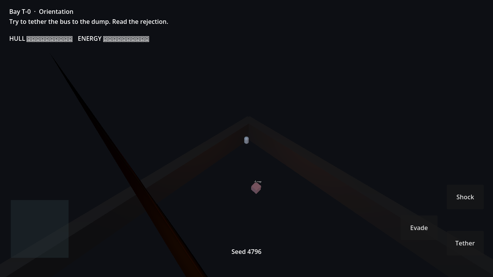

# RELAY//BREACH

Isometric action in a failing orbital power station. You get one active energy tether. The same link drops a shield, arms a hazard coil, jams a medic, opens a door, or charges the extract.



This is a playable vertical slice (about 5–10 minutes), not a finished commercial game. Version **0.9.0**. Desktop frame rate on reference hardware is **UNVERIFIED**.

## Play

Keyboard: **WASD** camera-relative strafe (A is screen-left, D is screen-right), **Space** evade, **J** shock, **click two endpoints** or **Q** then **E** to tether, **Esc** pause. Controller: left stick, **A** evade, **X** shock, **LB** cycle, **B** confirm, **Start** pause. **Shift+F10** restores the default keys.

Objective: finish the bay tutorial, clear four encounters (order changes with the seed), pick upgrades, then hold **reactor → extract** until the extract locks.

Pre-release builds (Linux x86_64 and a web zip), not a 1.0: [v0.9.0](https://github.com/eugeneabongo9-cmyk/relay-breach/releases/tag/v0.9.0). The Linux binary was not played on a desktop GPU. Host the web zip yourself. Threads are off.

## Engine

Godot **4.7.2.stable.official.ed1daf0bf**  
Editor: <https://github.com/godotengine/godot-builds/releases/download/4.7.2-stable/Godot_v4.7.2-stable_linux.x86_64.zip>  
Templates: <https://github.com/godotengine/godot-builds/releases/download/4.7.2-stable/Godot_v4.7.2-stable_export_templates.tpz>

```bash
godot --path .          # open or press F5
godot --headless --path . --import --quit
godot --headless --path . -s res://tests/run_tests.gd
```

Compatibility renderer. Web export disables threads so the page does not need cross-origin isolation.

## Interesting systems

- Tether rules, with an explicit rejection reason: [scripts/rules/tether_rules.gd](scripts/rules/tether_rules.gd)
- Enemy FSM, including stuck-target sidestep, with no scene dependency: [scripts/rules/enemy_brain.gd](scripts/rules/enemy_brain.gd)
- Versioned room-boundary saves and a separate settings file: [scripts/autoload/save_service.gd](scripts/autoload/save_service.gd)

## Layout

```text
data/content.json          tuning, rooms, upgrades
scripts/rules/             pure rules and the content validator
scripts/autoload/          content, saves, input, audio
scripts/game/              room loop, bodies, HUD
tests/run_tests.gd         unit checks plus a scripted playthrough
```

Pause is a flag. It does not call `get_tree().paused`, so the menu keeps running. Hit-stop is camera trauma only and does not freeze combat timers. Cosmetic RNG is `seed ^ 0x5A17C0DE` and does not pick rooms or upgrades.

## Tests and builds

Local equivalent of CI:

```bash
sh tools/check.sh
```

A headless stress yard of 24 pursuers measured **median 173 µs, p95 210 µs, p99 285 µs** per logic tick on the build machine (120 ticks, Godot 4.7.2 headless). That is not a 1080p frame-time measurement. See [docs/performance.md](docs/performance.md).

Release exports (local, this session):

| Target | Result |
| --- | --- |
| Web, threads off | `build/web/index.html` exported |
| Linux x86_64 | `build/linux/relay-breach.x86_64` exported |

Web and Linux binaries were produced. Playing the Linux binary on a desktop GPU was not done here. Checksums from that export are in [docs/RELEASE_CHECKLIST.md](docs/RELEASE_CHECKLIST.md).

## License

Code in this repository: MIT. See [LICENSE](LICENSE). Godot is MIT. Art and audio are procedural. See [docs/ASSETS.md](docs/ASSETS.md).

## Limits

No claim of 60 fps, controller certification, or a finished balance pass. Debug overlay (F3), room restart (F4), stress yard (F6), and the clipboard report (F8) exist only in debug builds.

## Contributing

Enemy, room, and tether numbers live in [data/content.json](data/content.json). Run `sh tools/check.sh` with Godot 4.7.2 before sending a change. Do not commit `.godot/` or `build/`.
